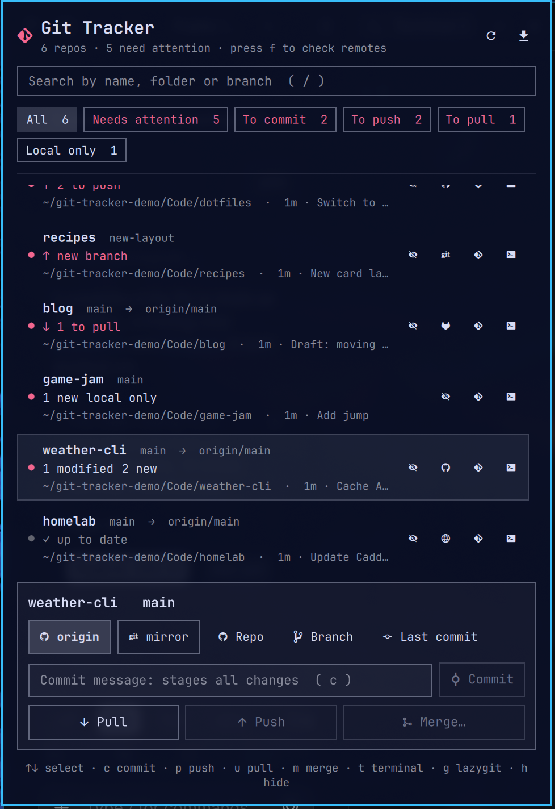

# Git Tracker

Every git repo on your computer in one bar panel. It finds them for you and shows which
ones have changes to commit, commits to push, or new commits to pull. You can commit,
push, pull and merge without leaving the panel.

It works with your **local** git, so any host works: GitHub, GitLab, Codeberg, Gitea,
Forgejo, Bitbucket, a self-hosted server, or no remote at all. Push and pull use the
remotes and credentials you already have set up. There's no account or token to set up.



## Install

```bash
omarchy plugin add https://github.com/matthewjaybarr-png/omarchy-git-tracker.git
omarchy plugin enable matthewjaybarr.git-tracker
omarchy bar put matthewjaybarr.git-tracker --section left
```

Plugins land disabled so you can read the code first. Requires `git` and `python3` (both
ship with Omarchy). `lazygit` is optional.

To remove it:

```bash
omarchy plugin remove matthewjaybarr.git-tracker
```

Your repos are not touched, and the plugin keeps no data of its own.

## Using it

The bar icon shows how many repos need attention. Click it to open the panel.
Right-click rescans and middle-click checks the remotes.

- **The list** puts repos that need attention first, then the most recently committed.
  Each row shows the branch, badges (`3 modified`, `↑ 2 to push`, `↓ 1 to pull`,
  `merge in progress`…), the folder, and the last commit.
- **Filters**: All, Needs attention, To commit, To push, To pull, Local only. Use ←/→ to switch.
- **Search** with `/` by name, folder or branch.
- **Select a repo** to get the action card:
  - **Commit**: type a message and press Enter. All changes are staged, including new files.
  - **Push**: pushes your commits. A branch that has never been pushed is published to
    `origin` (or the first remote) with its upstream set.
  - **Pull**: pulls new commits from the upstream.
  - **Merge…**: pick another local branch, then confirm. On a conflict, fix the files,
    commit from the card, or press **Abort merge**.
- **Open** a repo on its host (double-click or Enter), in a terminal (`t`), in lazygit
  (`g`), or in your file manager (`o`).
- **Links into the site**: the action card has buttons for the repo, the current branch, a new
  pull request for it, and the last commit. Each one appears only if the remote has it, so the
  branch must be pushed, and the commit link needs your last commit pushed too. This works on
  GitHub, GitLab, Gitea/Forgejo/Codeberg and Bitbucket. For other hosts only the repo link
  shows. If the repo has several remotes (say a GitHub mirror of a Codeberg repo), pick which
  one the links go to.
- **Add a remote** to a local-only repo: type its address (or set a template, below) and press
  Add remote, then Push to publish the branch.
- **Hide** a repo you're done with (the eye button or `h`). It's added to **Folders to
  skip**; remove it from that setting to bring it back.

When an action fails, the card shows git's message and a plain-English hint, such as
"pull first, then push" or "your SSH key isn't set up for this host".

| Key | Action | Key | Action |
|-----|--------|-----|--------|
| ↑ ↓ | select repo | ← → | filter |
| Enter | open on the web | / | search |
| c | commit message | p | push |
| u | pull | m | merge |
| t | terminal | g | lazygit |
| r | rescan | f | check remotes |
| o | file manager | h | hide repo |

## Settings

Open the widget's settings in the bar editor.

| Setting | Default | |
|---------|---------|---|
| Folders to scan | `~` | Comma separated. |
| Folders to skip | (none) | Comma separated, e.g. `~/vendor, ~/scratch`. |
| Depth | 4 | How many folders deep to look. Hidden folders, `node_modules`, `venv`, `target`, `build` and `dist` are always skipped. |
| Rescan every | 300 s | Local only, no network. |
| Check remotes in the background | off | Runs `git fetch` on every repo. Off by default because it uses the network. |
| Background check every | 1800 s | |
| Remote whose site links open | `origin` | Used when a repo has more than one remote. |
| Web host overrides | (none) | `ssh-host=web-host`, a site type, or both, e.g. `git.corp=gitlab.corp.com gitlab, code.me.net=forgejo`. SSH aliases from `~/.ssh/config` are resolved on their own. |
| Remote for local-only repos | (none) | Prefills Add remote. `{name}` becomes the folder name, e.g. `git@codeberg.org:you/{name}.git`. |

## Privacy and safety

- Nothing leaves your machine except the `git fetch`, `push` and `pull` you trigger (or
  turn on). Those go to the remotes you configured.
- Git never prompts for anything: `GIT_TERMINAL_PROMPT=0`, SSH in batch mode. A remote that
  needs a password fails with a hint instead of hanging.
- Branch names are validated before a merge, and commands run as argument lists, never
  through a shell. Only `https://` links are opened in the browser.
- Scans never run programs named by a repo's own config: fsmonitor, filter drivers, signature
  checks and hooks are switched off, and submodules aren't entered. A background fetch skips
  repos whose own config sets credential helpers, proxies, URL rewrites or transport programs.
- A merge checks that the branch you confirmed is still checked out before it runs.
- Add remote only accepts `https://`, `ssh://` and `user@host:path` addresses, and only on a
  repo that has no remote yet.
- No force push, no reset, no rebase. The most destructive button is Abort merge.

## Limits

- A repo nested inside another repo isn't listed.
- The scan stops at 400 repos.
- Changes inside submodules aren't counted.
- Commit always stages everything. To stage part of a change, use lazygit (`g`).

## Development

```bash
python3 -m unittest discover -s tests
node tests/model.test.mjs
omarchy plugin validate .
```

## Marketplace submissions

Each release is verified by the [Omarchy plugin marketplace](https://plugins.omarchy.org) before it reaches `main`.

| Version | Commit | Submission | Status |
|---|---|---|---|
| 1.2.0 | [`6653df8`](https://github.com/matthewjaybarr-png/omarchy-git-tracker/commit/6653df85af8dba82321f5766f995def3cb5da604) | [omacom/omarchy-plugin-marketplace#15922](https://github.com/omacom/omarchy-plugin-marketplace/issues/15922) | Validated, awaiting maintainer approval |

MIT licensed.
